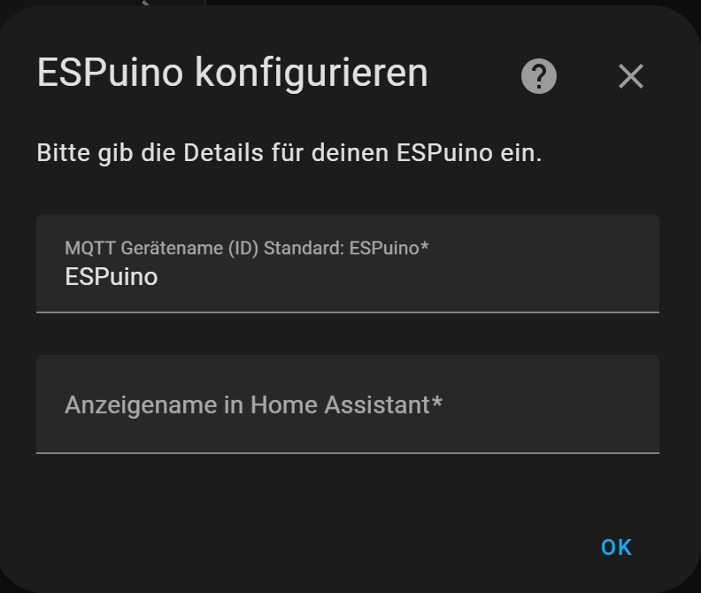
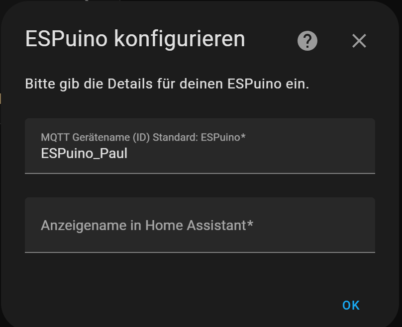

# ESPuino Home Assistant Integration


---

Fully integrate your [ESPuino](https://github.com/biologist79/ESPuino) RFID audio player into Home Assistant!  
This custom integration lets you control ESPuino via MQTT and monitor its status directly from Home Assistant.

---

[](https://github.com/hacs/integration) 


 [](https://github.com/DexXxter007/ESPuino_HA_Integration/releases)

 [](https://github.com/DexXxter007/ESPuino_HA_Integration/releases)


---
[](https://my.home-assistant.io/redirect/hacs_repository/?owner=DexXxter007&repository=ESPuino_HA_Integration&category=Integration)


## 🔧 Features

- Media control (play, pause, next/previous track, volume)
- Display current track information via MQTT
- Control lock, sleep timer, and other functions
- UI integration via Config Flow
- Compatible with Home Assistant 2023.x+

---

## 📦 Requirements

- A running MQTT broker
- A properly configured [ESPuino](https://github.com/biologist79/ESPuino) device with MQTT enabled
- Home Assistant with MQTT integration set up

---

## 🚀 Installation

### Via HACS (recommended)

1. Open HACS → **Integrations** → Three-dot menu → **Custom repositories**
2. Add the repository: `https://github.com/DexXxter007/ESPuino_HA_Integration`
3. Category: `Integration`
4. After adding, search for `ESPuino Integration` in HACS and install it
5. Restart Home Assistant

### Manual Installation

1. Download the [ZIP archive](https://github.com/DexXxter007/ESPuino_HA_Integration/archive/refs/heads/main.zip)
2. Extract it into:  
   `<config>/custom_components/espuino/`
3. Restart Home Assistant

---

## ⚙️ Setup

After restarting Home Assistant:

1. Go to **Settings → Devices & Services → Add Integration**
2. Search for **ESPuino Integration**
3. Enter a Name manually, 
4. You're done – entities will be created automatically




## 📡 Required ESPuino MQTT Configuration

For this integration to work correctly, your `settings.h` file in the ESPuino firmware must be properly configured with MQTT support.

Below is an example snippet that shows how to define MQTT topics:

```cpp
#ifdef MQTT_ENABLE
  constexpr uint16_t mqttRetryInterval = 60;
  constexpr uint8_t mqttMaxRetriesPerInterval = 1;
  #define DEVICE_HOSTNAME "ESP32-ESPuino" // Default MQTT ID
  constexpr const char topicSleepCmnd[] = "media/ESP32/ESP32-ESPuino/sleep/set";
  constexpr const char topicSleepState[] = "media/ESP32/ESP32-ESPuino/sleep";

Note: By default there is no topic prefix — topics are in the form `<device_id>/<state>` for state updates and `<device_id>/<command>/set` for commands. If you prefer a prefixed structure you can set `topic_prefix` to something like `media/ESP32`, which will result in `media/ESP32/<device_id>/<state>` and `media/ESP32/<device_id>/<command>/set`.

For example (default, no prefix):
```
// Commands:
ESPuino-AABBCCDDEEFF/sleep/set
ESPuino-AABBCCDDEEFF/rfid/set
// States:
ESPuino-AABBCCDDEEFF/sleep
ESPuino-AABBCCDDEEFF/rfid
ESPuino-AABBCCDDEEFF/track
```

For example (with `topic_prefix = "media/ESP32"`):
```
// Commands:
media/ESP32/ESPuino-AABBCCDDEEFF/sleep/set
media/ESP32/ESPuino-AABBCCDDEEFF/rfid/set
// States:
media/ESP32/ESPuino-AABBCCDDEEFF/sleep
media/ESP32/ESPuino-AABBCCDDEEFF/rfid
media/ESP32/ESPuino-AABBCCDDEEFF/track
```
```
## ⚠️ Important for multi-device setups

The default MQTT ID is ESPuino.
If you're using multiple ESPuino devices, each one must have a unique MQTT ID.
To do this, change DEVICE_HOSTNAME in settings.h and adjust all MQTT topics accordingly.

For example:
```cpp
#ifdef MQTT_ENABLE
  constexpr uint16_t mqttRetryInterval = 60;
  constexpr uint8_t mqttMaxRetriesPerInterval = 1;
  #define DEVICE_HOSTNAME "ESP32-ESPuino_Paul" // Change Name
  constexpr const char topicSleepCmnd[] = "media/ESP32/ESP32-ESPuino_Paul/sleep/set";
  constexpr const char topicSleepState[] = "media/ESP32/ESP32-ESPuino_Paul/sleep";
```




---

## 🧪 Example Entities

Once set up, the following entities will be available:

- `media_player.espuino`
- `sensor.espuino_track`
- `switch.espuino_sleep`
- `button.espuino_play_next`
- `number.espuino_volume`

---

## 🛠️ Troubleshooting

- **Integration not found:** Make sure `custom_components/espuino` exists in your config folder
- **MQTT not working:** Check your MQTT topics and broker connection
- **HACS warning:** Ensure you're using a [tagged release](https://github.com/DexXxter007/ESPuino_HA_Integration/releases) (`v1.0.0`, etc.)

---

## 🗒️ Changelog

### v1.0.0
- Initial release with media player support and MQTT integration

---

## 👤 Credits

- [DexXxter007](https://github.com/DexXxter007) – Development
- [biologist79](https://github.com/biologist79/ESPuino) – ESPuino project (hardware & firmware)

---

## 🪪 License

MIT License – free to use, modify, and distribute.
